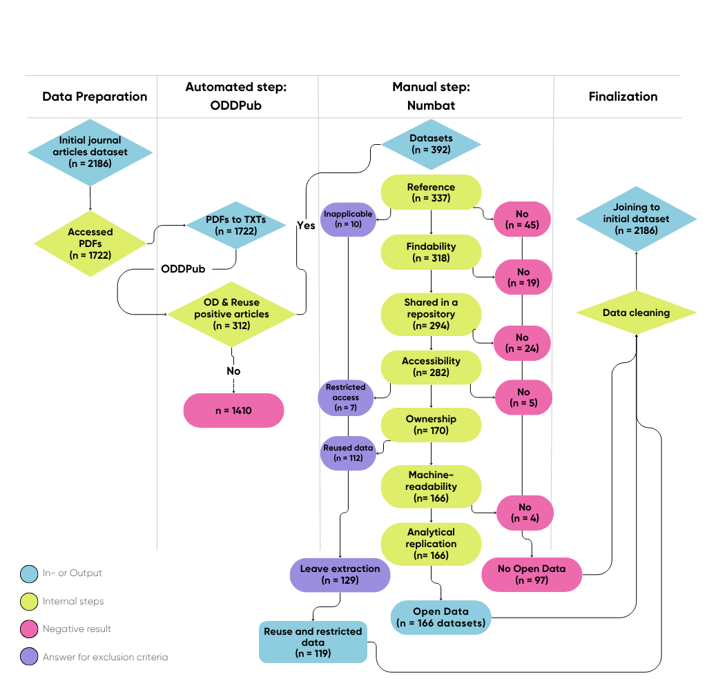

# Open Earth Sciences Dashboard

## Authors

Anastasiia Iarkaeva ([anastasiia.iarkaeva\@charte.de](mailto:anastasiia.iarkaeva@charte.de)), Evgeny Bobrov ([evgeny.bobrov\@bih-charite.de](mailto:evgeny.bobrov@bih-charite.de)) - QUEST Center for Responsible Research, Berlin Institute of Health

## Description

The [Open Earth Sciences dashboard](https://quest-open-earthsciences.charite.de/) was developed as part of the project [Berlin University Allience (BUA) Open Science Magnifiers (2024-2026)](https://www.berlin-university-alliance.de/en/commitments/research-quality/forschung/ongoing/dashboard/index.html). It includes the following metrics specifically for the Earth Sciences Department at Freie Universität Berlin:

- Open Access of journal publications

- Licensing of journal publications

- Open Access of non-journal publications by genre

- Persistent identifiers of non-journal publications

- Open Data of journal publications

- Repository types of openly shared data underlying journal publications

#### Journal and non-journal article publications:

The dashboard is extended yearly with new publications data provided by the [Freie Universität Berlin University Bibliography](https://www.fu-berlin.de/en/sites/ub/service/unibibliografie/index.html) (CRIS) and enriched with manually researched information. Detailed information on the data enrichment for the tab '[Open Access and Licenses](https://quest-open-earthsciences.charite.de/#tabOA)' can be found at [10.5281/zenodo.10998218](https://doi.org/10.5281/zenodo.10998218). Current dataset includes publications from 2016 to 2024.

#### Open Data:

Open data detection follows the approach applied at Charité Universitätsmedizin Berlin (detailed methodology to be published in September 2026), using the extended [ODDPub algorithm](https://github.com/quest-bih/oddpub). The following figure shows the workflow and main numbers:

## Publications

#### Journal and non-journal article publications:

Our [paper](https://doi.org/10.5281/zenodo.14170751) from the STI 2024 conference describes the results of an analysis of Open Access statuses, Creative Commons licenses, and persistent Identifiers for journal and non-journal outputs between 2016 and 2022 (<https://doi.org/10.5281/zenodo.14170751>).

Datasets related to the topics are findable in repository under 'data' folder and persistently published under [10.5281/zenodo.10997719](https://doi.org/10.5281/zenodo.10997719).

#### Open Data:

The methodology of Open Data validation is planed to be published September 2026.

Datasets related to the topic are findable in repository under 'data' folder and are planed to be published in September 2026.

## Funding

The project is funded by the German Federal Ministry of Education and Research (BMBF) and the State of Berlin within the Excellence Strategy of Federal and State Governments through the [Berlin University Alliance](https://www.berlin-university-alliance.de/en/), Grant number 312_OpenCall_1.
